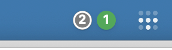
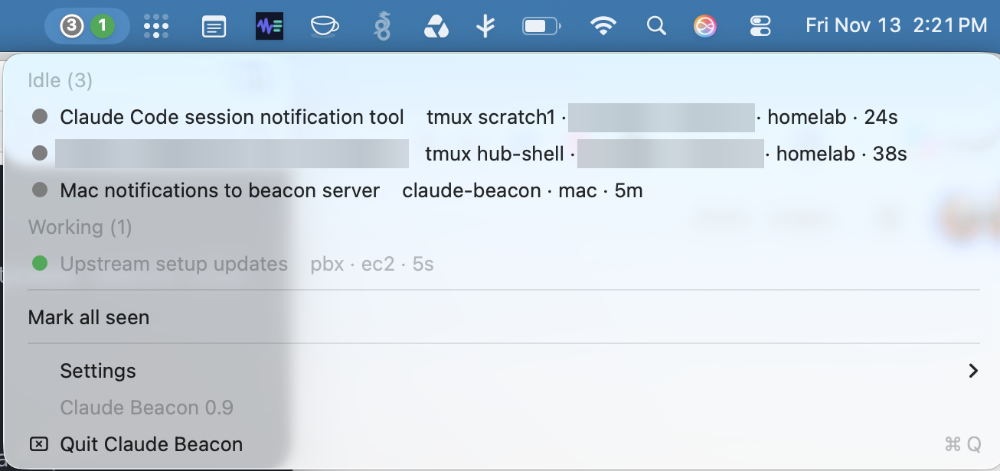
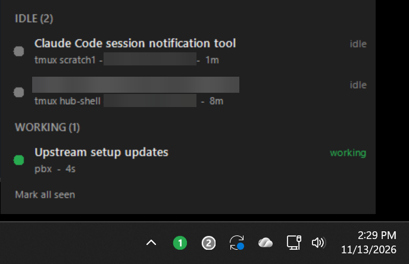

# claude-beacon 🚦

**See which of your Claude Code sessions are working, which have gone idle, and which are waiting
on you, from your Mac menu bar or Windows taskbar. Across every machine you run them on.**

If you run several [Claude Code](https://claude.com/claude-code) sessions at once (in tmux, over SSH,
on a cloud VM, in a pile of terminal tabs), you know the routine: cycle through every tab to find
the one that finished ten minutes ago, or the one stuck on a question. claude-beacon puts the
answer in one place.

> Unofficial. Not affiliated with or endorsed by Anthropic.

<p align="center"></p>

## What you get

- **Two dots with counts.** Gray or amber for sessions that **need you**, green for sessions
  **working**. Amber means at least one is asking you something.
- **A notification** when a session finishes or starts asking you something.
- **A session list** with real names (your `/rename` name, or Claude's auto title), plus the tmux
  session, project folder and machine.
- **Your terminal tab lights up too.** The tab running a session that's asking you turns yellow in
  Windows Terminal, iTerm2 3.6+, Ghostty and ConEmu, even over SSH and inside tmux.
- **Every machine, one view.** Sessions on your laptop, desktop, home server and cloud VMs all
  report to a single small server, and every computer you sit at shows the same picture.

<p align="center"></p>

## How it works

```
  Machines running Claude Code               You, at any computer
  (laptop, desktop, server, cloud VM)
                                          ┌──▶ Mac menu bar app
  Claude Code ──hook──▶  beacon server  ──┤
                         (one, tiny)      └──▶ Windows tray app
       │
       └──▶ the terminal tab running that session (yellow when it's asking you)
```

1. A **hook** in Claude Code reports each session's state (working, idle, asking you) every time it
   changes. It's a short bash script that never blocks or slows Claude down.
2. The **beacon** is a single-file Python server with no dependencies. It keeps the current state
   of every session and pushes changes to the apps.
3. The **apps** draw the dots, list the sessions and send notifications.

More detail, including how "asking you" is detected: [docs/how-it-works.md](docs/how-it-works.md).

## What you need

| Piece | Where | Requires |
|---|---|---|
| Beacon server | One always-on machine that every other machine can reach | Docker, or Python 3.8+ |
| Hook | Every machine where you run Claude Code (Linux, macOS, WSL) | `bash`, `curl`, `jq` |
| Mac app | Each Mac you look at | macOS 13+, Swift toolchain (Xcode or Command Line Tools) |
| Windows app | Each Windows PC you look at | Windows 10 or 11, nothing else |

If your machines aren't all on one home or office network, you also need a private network
between them. [Tailscale](https://tailscale.com) is the easy answer and is free for personal use:
see [docs/networking.md](docs/networking.md).

## Quick start

Clone the repo on each machine you set up:

```sh
git clone https://github.com/kevinrossen/claude-beacon.git
cd claude-beacon
```

### 1. Start the beacon server

On the always-on machine (a home server, a small cloud VM, a Raspberry Pi):

```sh
cd server
cp server.env.example server.env
sed -i.bak "s/replace-with-your-token/$(openssl rand -hex 24)/" server.env && rm server.env.bak
docker compose up -d
```

Check it's up with `curl http://localhost:8799/health`, which should print `{"ok": true}`. Your
token is in `server/server.env`; every other machine needs it.

No Docker? Run `BEACON_TOKEN=<token> BEACON_STATE_FILE=./state.json python3 server/beacon.py`
under systemd, launchd or tmux instead.

> 🔒 The beacon speaks plain HTTP, protected by the token. Keep it on your LAN or a private
> network like Tailscale. Don't open port 8799 to the internet.

### 2. Install the hook on every machine where you run Claude Code

```sh
hook/install.sh --url http://<beacon-address>:8799 --token <token>
```

This copies the hook into `~/.claude/hooks/`, saves the URL and token, registers the hook in
`~/.claude/settings.json` (after backing it up, and without touching your other hooks), turns on
tmux passthrough if you use tmux, and checks it can reach the beacon.

Run it yourself in a terminal. If you ask Claude Code to run it for you, auto mode will likely block
it, since it edits Claude Code's own settings. Inside a Claude Code session you can prefix it with
`!` to run it as you.

Add `--name <name>` to choose how this machine is labeled in the apps (say `--name laptop`
instead of a hostname like `ip-172-31-28-108`). Rerun with just `--name` to change it later.

New Claude Code sessions report from then on. Sessions already running pick it up when restarted.

### 3. Install an app on each computer you look at

**Mac:**

```sh
mac/install.sh --url http://<beacon-address>:8799 --token <token>
```

It builds the app, installs it to `~/Library/Application Support/claude-beacon/`, sets it to start
at login and launches it. The first notification makes macOS ask whether **Script Editor** may
send notifications (that's how the app sends them); allow it.

**Windows:** copy the `windows` folder to the PC, then in PowerShell:

```powershell
powershell -ExecutionPolicy Bypass -File .\windows\install.ps1
```

It asks for the URL and token, sets the app to start at login and launches it. Windows 11 tucks new
tray icons behind the `^` arrow; drag them onto the taskbar so they're always visible.

That's it. 🎉 Start a Claude Code session and watch the green dot appear.

## Using it

| You see | It means |
|---|---|
| 🟢 green dot, number | That many sessions are working. |
| ⚪ gray dot, number | That many sessions are idle: finished their turn, waiting for your next prompt. A white rim means one finished since you last looked. |
| 🟡 amber dot, number | At least one of those sessions is asking you something: a question, a permission prompt, or a plan to approve. |
| faint ring | Nothing in that state right now. |
| gray `!` | The app can't reach the beacon. |

- **Mac:** click the dots for the session list. Click a session to mark it seen.
- **Windows:** left-click an icon for the session panel, right-click for the menu.
- **Mark seen** clears the white rim and mutes the amber, but the session stays counted. It's
  still idle, after all. It drops out of the count when it starts working again or ends.

<p align="center"></p>

### Settings

Both apps have a **Settings** menu, saved to the app's `client.json`:

| Setting | Options |
|---|---|
| Icons | **Needs you + Working** (default), Asking + Idle + Working, Asking + Working, Needs you only, Asking only |
| Notifications | When a session finishes or asks you (default), only when it asks you, off |
| Hide icons with nothing to show | off (default) / on |
| Start at login | on / off |
| Light beside the notch when asked (Mac) | on (default) / off. A small amber light next to the MacBook notch. |

`client.json` lives at `~/.config/claude-beacon/client.json` on a Mac and
`%APPDATA%\claude-beacon\client.json` on Windows. Every key is listed in
[docs/how-it-works.md](docs/how-it-works.md#configuration-reference).

### Session names

Each session shows up under the best name available:

1. The name you gave it with `/rename` in Claude Code.
2. Otherwise, the title Claude generates for the conversation.
3. Alongside: the tmux session it runs in (if any), the project folder, and the machine name
   once sessions come from more than one machine. Set a friendly machine name with
   `hook/install.sh --name <name>`.

Tip: `/rename api-refactor` makes a session easy to spot in the list.

### Terminal tab indicator

The hook also marks the terminal tab running each session: a busy indicator while it works, yellow
while it's asking you, cleared when it's done. In Windows Terminal this shows on the tab and on the
taskbar icon. Inside tmux it needs `set -g allow-passthrough all`, which the hook installer adds for
you. To turn it off, add `BEACON_TERMINAL=0` to `~/.config/claude-beacon/env`.

## Updating

Pull the repo, then rerun the installers on each machine. They keep your URL, token and settings.

```sh
git pull
hook/install.sh            # on machines running Claude Code
mac/install.sh             # on Macs
```

On Windows, delete the old `windows` folder before copying the new one over (`scp -r` into an
existing folder nests the copy inside it), then rerun `install.ps1`.

## Uninstalling

```sh
hook/install.sh --uninstall      # removes the hook and its settings.json entries
mac/install.sh --uninstall       # removes the Mac app and its login item
```

```powershell
powershell -ExecutionPolicy Bypass -File .\windows\install.ps1 -Uninstall
```

Then `docker compose down` in `server/` on the beacon machine.

## More

- [docs/networking.md](docs/networking.md): connecting machines across networks with Tailscale
- [docs/how-it-works.md](docs/how-it-works.md): states, detection, API, configuration reference
- [docs/troubleshooting.md](docs/troubleshooting.md): when a dot doesn't show what you expect
- [CHANGELOG.md](CHANGELOG.md) · [CONTRIBUTING.md](CONTRIBUTING.md) · [SECURITY.md](SECURITY.md)

## Limitations

- **"Asking you" is a best guess** when Claude asks in plain text. Permission prompts, multiple
  choice questions and plan approvals are always caught; a turn that ends with a question mark is
  caught too; "let me know what you think" isn't. Those still show up as idle, which is why the
  default view counts idle and asking together.
- **Claude Code running natively on Windows** (not in WSL) has no hook yet.
- **One beacon per person.** Everyone who connects with the token sees all its sessions.
- A session killed without exiting (closed SSH connection, `kill -9`) can linger as "working"
  until the beacon clears it after 6 hours of silence.

## License

[MIT](LICENSE)
